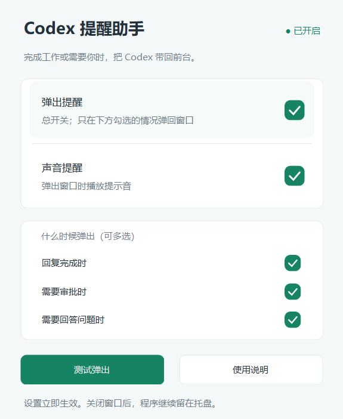

# Codex 提醒助手

Windows 托盘工具：切到其他软件后，在 Codex 回复完成、需要审批或回答问题时，尝试将 Codex 桌面窗口显示到前台。

**[下载单文件 EXE 安装程序](https://github.com/ZhuQueXuan/codex-reminder/releases/latest/download/CodexReminder-Setup.exe)** · **[所有版本](https://github.com/ZhuQueXuan/codex-reminder/releases)** · [使用说明](Docs/使用说明.md)

独立开发的非官方工具，与 OpenAI 无隶属关系。

## 功能

- 右下角托盘图标，右键控制提醒，双击打开设置。
- 独立选择回复完成、需要审批、需要回答问题三种情况，可任意组合。
- 弹出提醒总开关、声音开关、即时保存，暂停或重启后保留偏好。
- 浏览器或连接器确认界面的补充只读检测，不替用户批准、拒绝或回答。
- 手动测试弹出、按屏幕缩放、退出后停止提醒。
- 单文件安装 EXE 自动解包，可创建桌面快捷方式，也提供 ZIP 版。



## 下载与首次使用

需要 Windows 10/11、.NET Framework 4.8 或更高版本，以及已经安装并登录的 Codex 桌面应用。本项目主要在 Windows 11 上检查，其他系统和电脑仍需验证。

1. 下载 **[CodexReminder-Setup.exe](https://github.com/ZhuQueXuan/codex-reminder/releases/latest/download/CodexReminder-Setup.exe)**。
2. 打开 Codex，双击安装程序，点击“安装并启动”。默认安装到 `%LOCALAPPDATA%\CodexReminder\版本号`，可更改位置，不需要管理员身份。
3. **在 Codex 中信任提醒配置。** 只信任带有 `CodexAttention` 的三个事件。若桌面没有事件审阅入口，在安装目录双击“打开事件审阅终端.cmd”，进入后输入 `/hooks`。终端和桌面应使用相同的用户配置目录。程序不会替用户完成信任。
4. 回到 Codex，重新开始一个聊天回合，切到其他软件检查自动弹回。未信任前，自动事件提醒不会生效。
5. 以后双击桌面的“Codex提醒助手”快捷方式启动。找不到托盘图标时，展开右下角隐藏图标。

也可下载 **[ZIP 版](https://github.com/ZhuQueXuan/codex-reminder/releases/latest/download/CodexReminder-Portable.zip)**，完整解压后双击“首次安装并启动.cmd”，完成信任；以后双击“启动提醒助手.cmd”。不要在压缩包中直接运行，请保留完整安装目录。

发行文件未进行代码签名。[SHA256SUMS.txt](https://github.com/ZhuQueXuan/codex-reminder/releases/latest/download/SHA256SUMS.txt) 提供校验值：在 PowerShell 中执行 `Get-FileHash .\CodexReminder-Setup.exe -Algorithm SHA256` 后比较。

## 设置提醒时机

右键图标 → **设置与状态** → **什么时候弹出（可多选）**。

| 选项 | 情况 |
| --- | --- |
| 回复完成时 | 一个聊天回合结束 |
| 需要审批时 | 权限申请，或检测到工具待确认界面 |
| 需要回答问题时 | Codex 调用支持的提问工具 |

例如只勾“需要审批时”，完成和提问就不会弹出或发声。默认三项全开，全不勾选则不自动提醒。总开关暂停后保留选择。手动“测试弹出”不受类型开关限制。

关闭设置窗口会留在托盘，右键“退出程序”才停止提醒。没有默认设置开机启动。

## 工作方式与限制

安装合并当前用户的 `hooks.json`，保留其他事件，注册 `Stop`、`PermissionRequest` 和匹配提问工具的 `PreToolUse`。配置目录优先使用 `CODEX_HOME`，未设置时使用 `%USERPROFILE%\.codex`。备份和诊断日志保存在 `%LOCALAPPDATA%\CodexAttention`。

补充审批检测只读取决策按钮名称、启用状态和明确的等待状态，不执行点击，不读取文档正文，不保存对话、审批内容或凭据。同一待审批控件只提醒一次。

- 完成表示一个回合结束，未必是整个长期任务完成；自动审批可能自行处理申请。
- 未显示或未向 Windows 暴露控件的审批，以及绕过事件机制的提问，可能漏报。
- 锁屏、安全桌面、部分全屏程序和 Windows 焦点限制可能阻止弹回，不修改系统焦点策略。
- 显示 Codex 主窗口，不自动跳到具体聊天。多窗口、远程、云端及多屏尚未完整验证。
- 移动安装目录后，需退出旧程序，在新位置重新安装并审阅变更后的事件路径。

## 从源码构建

使用 Windows PowerShell 和系统现有 .NET Framework 编译器，不需要 Node、Python 或第三方库。在仓库根目录执行：

```powershell
# 先退出本目录的托盘实例
powershell.exe -NoProfile -ExecutionPolicy Bypass -File .\Src\Build.ps1
powershell.exe -NoProfile -ExecutionPolicy Bypass -File .\Src\Package.ps1 -ReleaseVersion 2026.10.13.2
powershell.exe -NoProfile -ExecutionPolicy Bypass -File .\Src\BuildInstaller.ps1 -ReleaseVersion 2026.10.13.2
```

程序生成在 `App`，发行文件生成在 `Releases`。安装包自动包含 EXE 与同名高清屏 `.exe.config`，不要单独移动程序。构建不覆盖已有同版本安装 EXE，再次发布需换版本号。

若直接使用源码目录，构建后双击 `Launchers\安装提醒.cmd`，完成信任，再双击 `Launchers\启动托盘.cmd`。

| 目录或文件 | 用途 |
| --- | --- |
| `Src` | 托盘、窗口控制、事件处理、审批检测、安装与构建源码 |
| `Config` | 默认开关与高清屏配置 |
| `Launchers` | 安装、启动、暂停、恢复和测试入口 |
| `Tests` | 事件、控件、生命周期、打包和安装检查 |
| `Docs` | 使用说明、预览与验证范围 |
| `Attention.ps1` | 稳定的事件入口 |

## 验证

已检查事件类型组合、中文/表情 UTF-8 输入、配置保留、托盘启停、真实控件同步、原生审批夹具、ZIP 重定位与 EXE 解包。详见 [验证范围](Docs/验证范围.md)。

```powershell
powershell.exe -NoProfile -ExecutionPolicy Bypass -File .\Tests\verify-reminder.ps1
powershell.exe -NoProfile -ExecutionPolicy Bypass -File .\Tests\verify-event-stdin.ps1
powershell.exe -NoProfile -ExecutionPolicy Bypass -File .\Tests\verify-event-selection.ps1
# 先构建发行文件再运行以下两项
powershell.exe -NoProfile -ExecutionPolicy Bypass -File .\Tests\verify-package.ps1
powershell.exe -NoProfile -ExecutionPolicy Bypass -File .\Tests\verify-installer.ps1 -ReleaseVersion 2026.10.13.2
```

事件和生命周期测试会临时切换源码目录的设置并恢复，运行前先退出该目录的托盘。夹具与控件测试不操作用户的 Codex 决策按钮。另一台电脑的完整安装、信任与真实提醒，以及所有提问和审批路径，尚未逐项实测。

欢迎通过 Issues 提供版本、触发场景和不含敏感内容的诊断结果。

## 许可证

源码以 [MIT License](LICENSE) 发布。
